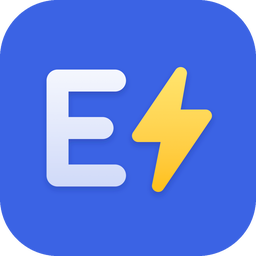
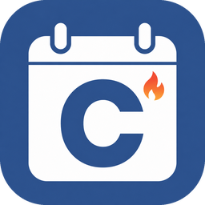

**기획부터 출시까지, 사용자 입장에서 화면을 만드는 프론트엔드 개발자입니다.**

 

## About

컴퓨터공학과를 전공한 개발자입니다. 
Flutter 앱 **칼캘**을 혼자 기획하고 개발해서 App Store에 출시했습니다. 
캡스톤 프로젝트 **EV Flow**에서는 프론트엔드와 앱을 맡아 iOS 앱을 출시했고, Android 앱도 곧 출시합니다.

기능을 만들기 전에 사용자가 이 화면에서 무엇을 하려는지부터 정리하는 편입니다.
학원 강사로 일하면서 어려운 개념을 쉽게 설명하고 문서로 남기는 데 익숙해졌습니다.

 

## Projects

###  EV Flow — AI 전기차 충전소 추천 앱

실시간 충전기 상태로 15 · 30분 뒤 혼잡도를 예측해서, 지금 가면 덜 기다리는 충전소를 추천합니다.

| | |
|---|---|
| **형태** | 캡스톤 팀 프로젝트 (FE / BE / AI, 4명) · 2026.09 ~ |
| **역할** | 프론트엔드 · 앱 |
| **상태** | iOS [App Store](https://apps.apple.com/kr/app/id6838172836) 출시 (1.0.1) · Android Play 비공개 테스트 중 (2026년 12월 출시 예정) |
| **Stack** | React Native (Expo), NativeWind · React 18, TypeScript, Vite, Tailwind CSS · TanStack Query, pnpm 모노레포 |
| **Links** | [App Store](https://apps.apple.com/kr/app/id6838172836) · [Web](https://evflowkr.app) · [Repository](https://github.com/2026-Capstone4/ev-flow) |

**서비스**
- 서울 마포구 급속 충전소 66곳(충전기 176기)의 상태를 5분 간격으로 수집, XGBoost로 혼잡도와 예상 대기 구간 예측
- 이동시간 + 대기시간 + 미래 혼잡도를 합쳐 추천 Top 3, 마포구 밖 서울은 지금 상태 기준으로 추천
- 전국 고속도로 휴게소 충전소를 노선별 · 지역별로 조회, 운영자 웹 대시보드(서울 구별 이용률 · 충전기 상태)

**내가 한 일**
- React 웹을 만든 뒤 React Native(Expo)로 새로 작성, 웹 · 앱 공용 로직을 `packages/core`로 분리
- 네이버 지도 네이티브 SDK로 충전소 마커 · 서비스 범위 표시, 카카오 · 네이버 지도 앱으로 길 안내 연결
- TanStack Query로 60초 폴링, 화면이 꺼지면 폴링 중단, 갱신에 실패하면 마지막 정상값을 유지하고 경고 표시
- App Store · Play 등록과 심사, 지원 · 개인정보 처리방침 페이지까지 출시 과정 전체 담당
- MSW로 API를 mock해 백엔드와 병렬 개발, Recharts로 운영자 대시보드 구현

 

###  칼캘 — 칼로리 캘린더

먹은 음식과 칼로리를 캘린더에 기록하고 AI로 분석·추천받는 앱

| | |
|---|---|
| **형태** | 1인 개발 · App Store 출시 (2026.08) |
| **역할** | 기획, 개발, 배포, 심사 대응 |
| **Stack** | Flutter, Dart |
| **Links** | [App Store](https://apps.apple.com/kr/app/id6802026331) · [Repository](https://github.com/kkyom/cal_cal_app) |

- Apple / Google 소셜 로그인, 회원탈퇴(계정 삭제)
- 음식·영양 데이터 외부 API 연동
- 식단 기록 기반 AI 분석 및 추천
- App Store 심사 피드백(Guideline 2.1)을 받고 대응해서 출시

 

## Tech Stack

| | |
|---|---|
| **Frontend** |  &nbsp; + TanStack Query |
| **Mobile** |  &nbsp; React Native (Expo), Flutter |
| **써본 적 있음** |  |
| **Collaboration** |  |

 

## Now

- EV Flow Android 앱 12월 Play 정식 출시 준비
- EV Flow iOS 앱 업데이트 · 운영

 

## Contact

